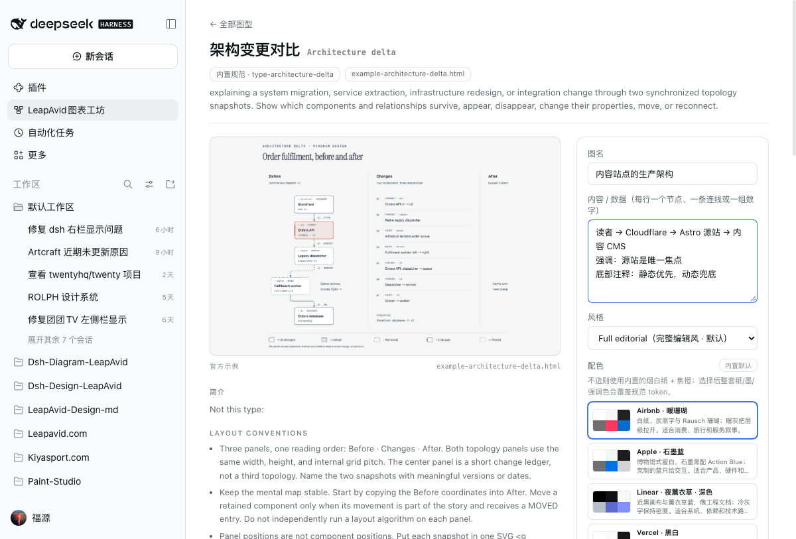

# LeapAvid图表工坊

> DSH 侧栏里的 50 种编辑级图表工作台。选一种图型、挑一套品牌配色、填一张表，直接在新会话里生成一张可发布的单文件 HTML 图表。默认只注入核心规范，也可以按需切换完整规范。


## 简介

LeapAvid图表工坊是一个 **DeepSeek Harness 客户端插件**。它把
[`diagram-design`](https://github.com/cathrynlavery/diagram-design) 的完整规范
**直接打包进插件**，变成可浏览、可检索、可填表的工作台，让“画一张架构图”从写
提示词变成选图型、填内容、点生成。

它不依赖 `dsh-ai-diagrams`，也不需要预先安装 `diagram-design` 技能或任何
`diagram_save` 工具。插件的宿主侧会按你选的图型、风格、配色和内容，从内置的
`skill/` 目录拼出一份自包含的生成提示词，再交给当前会话的模型直接产出图表。

生成结果是由模型产出的**单文件 HTML + 内联 SVG**，文字可选中、结构可编辑，
可以直接在浏览器里打开，也可以自行导出 SVG / PNG。默认视觉上沿用
`diagram-design` 的编辑风：灰纸底、发丝线、单一强调色、克制的字体层级；
选品牌配色后，纸、墨、强调色会整体替换，但版式与字体层级仍由所选风格决定。

## 功能

- **50 种图型**：架构图、架构变更对比、流程图、数据流、ER、甘特图、四象限、
  鱼骨图、桑基图、用户旅程、服务蓝图、Wardley 地图等，覆盖系统、产品、数据与
  组织场景。
- **内置完整规范，按需注入**：插件自带 `diagram-design` 的 SKILL.md、70 份 references
  与 5 个 HTML 起始模板，不联网、不读外部技能目录。默认「精简」只内联核心规范、
  本次图型与模板（约 45–85 KB），更细的参考按需读取；也可以一键切到「完整」，
  把全部参考内联（约 130–180 KB）。
- **列表页**：每张卡片带一张官方示例预览图，下面是中文名、英文名与技能原文的
  “适合用来画什么”；支持按中文名、英文名或用途即时搜索。
- **详情页**：正文列顶部是该图型的官方示例大图（点击全屏放大），下面依次是
  「简介」与技能里的布局规则、反模式与构图预算；右栏是生成表单与配色选择。
- **三种风格**：Full editorial（完整编辑风，默认）、Minimal light（浅色极简）、
  Minimal dark（深色极简）；可叠加手绘 `sketchy`、终端 `terminal` 或动效
  `motion`。
- **10 套品牌配色**：从 LeapAvid Design MD 的 84 套品牌设计语言中精选
  Airbnb、Apple、Linear、Vercel、Stripe、Notion、Claude、Binance、
  Starbucks、Mastercard。表单里直接看色盘和中文说明，选中后整套纸/墨/强调色
  覆盖 `style-guide` 的默认色；不选则保持原来的烟白纸 + 焦橙。
- **一键生成**：提交后先向宿主请求内置规范提示词，再新建会话、打开它，并把
  图型、风格与内容写进提示词；模型直接产出单文件 HTML，保存到工作区
  `diagrams/`。
- **复制提示词**：不想现在生成时，可以把整段提示词复制到任意会话里自己用。
  默认精简规范约 45–85 KB，切到完整规范约 130–180 KB。
- **响应式**：列表用 `auto-fill / minmax(248px, 1fr)` 铺满面板；详情页用容器查询
  跟随面板宽度切换两栏 / 单栏，而不是跟随窗口。



*详情页：左边读布局规则与官方示例，右边填内容、选规范档位与品牌配色。*

## 环境要求

| 依赖 | 说明 |
| --- | --- |
| DeepSeek Harness | 桌面版，已在 **0.2.x** 验证；需要支持客户端插件与侧栏槽位 |
| 会话模型 | 需要能接收中等长度提示词并写文件；默认精简规范约 45–85 KB，插件要求模型使用 `write` 落盘 |
| Node.js | 仅在开发 / 重新生成数据时需要；运行插件本身不需要额外 Node 进程 |

> 不再需要 `dsh-ai-diagrams`、`diagram-design` 技能或 `diagram_save`。
> 插件的 `index.js` 提供 `/api/diagram-leapavid/prompt` 宿主路由，生成规范
> 由插件自身携带。

## 安装

### 从 npm 安装

本插件已发布到 npm：[dsh-diagram-leapavid](https://www.npmjs.com/package/dsh-diagram-leapavid)。
当前仓库版本为 **0.4.2**。

> 0.4.0 已发布到 npm，包含内置 `skill/` 规范、10 套配色、`/api/diagram-leapavid/prompt` 路由与默认精简注入。0.4.1 修正本段发布状态说明；0.4.2 更新 README 截图，去掉 DSH 左栏，内容页只保留一张详情截图。

```bash
dsh plugin --profile desktop add dsh-diagram-leapavid
```

装好后确认 `~/.dsh/profiles/desktop/package.json` 的 `dsh.profile.bundles` 里包含
`"dsh-diagram-leapavid"`。如果插件命令只装了依赖、没有写入 bundles，手动补上：

```json
{
  "dsh": {
    "profile": {
      "bundles": [
        "...",
        "dsh-diagram-leapavid"
      ]
    }
  }
}
```

改完后重启 DSH。侧栏应该出现 **LeapAvid图表工坊** 入口，点开能看到 50 张图型卡片。

> 如果侧栏没有出现，先检查包名是否写进了 `bundles`，再看 DSH 日志里有没有
> client bundle 404。

### 从本地仓库安装 / 开发

想改代码后立即看到效果时，把仓库软链到 desktop profile，并在 `dependencies`
里用绝对路径的 `file:` 依赖：

```bash
ln -s "$PWD" ~/.dsh/profiles/desktop/node_modules/dsh-diagram-leapavid
```

```json
{
  "dependencies": {
    "dsh-diagram-leapavid": "file:/absolute/path/to/dsh-diagram-leapavid"
  }
}
```

同样确认 `dsh.profile.bundles` 里包含包名，然后重启 DSH。改 `client.js` 后刷新
页面即可；改 `index.js` 需要重新加载插件（或在插件管理里禁用再启用）。

## 使用

1. 打开侧栏的 **LeapAvid图表工坊**。
2. 在列表页搜索或滚动，选一种图型。
3. 在详情页右栏填写：
   - **图名**：会作为图表的标题。
   - **内容 / 数据**：每行一个节点、一条连线或一组数字；也可以直接写一段业务描述。
   - **风格**：Full editorial / Minimal light / Minimal dark。
   - **规范注入**：默认「精简 · 推荐」，只内联核心规范、本次图型与模板；切到
     「完整」则把全部参考内联。样式与配色不变，只影响提示词长度和细节量。
   - **配色**：10 套品牌配色任选，卡片上有 6 段色盘和中文说明；不选则用内置
     烟白纸 + 焦橙。选 **内置默认** 可随时恢复。
   - **可选叠加**：手绘 sketchy、终端 terminal、动效 motion。终端皮肤固定黑底
     橙字，勾选后会忽略品牌配色。
4. 点 **生成图表**。插件会请求内置规范提示词，新建会话并发送。
5. 模型按规范产出单文件 HTML + 内联 SVG，保存到工作区 `diagrams/` 下，例如
   `diagrams/architecture-20261122-214535.html`。

想自己控制对话时，点 **复制提示词**，把提示词粘到任意会话即可。

## 工作方式

```text
skill/SKILL.md + references + templates ─┐
                                        ├─ composePrompt ──▶ POST /api/diagram-leapavid/prompt
              palettes.json ────────────┘                              │
                                                                 client.js promptFor()
                                                                      │
                                                      新建会话 + 发送自包含提示词 ──▶ 模型产出
                                                                      │
                                                          diagrams/<slug>-<timestamp>.html
```

- `index.js` 是宿主侧：注册 `/api/diagram-leapavid/health`、
  `/api/diagram-leapavid/palettes` 与 `/api/diagram-leapavid/prompt`，校验图型、
  风格、配色、内容与规范档位（`spec`）。默认 `compact`：拼出核心 SKILL 章节、
  style-guide、primitives、layout budget、type-*.md、去示例模板，并附按需查阅
  路径；`full`：把 semantic-patterns、output-spec 等全部参考内联。两者都可追加
  一段覆盖 `style-guide` token 的品牌配色约束。
- `client.js` 是 DSH 的客户端 bundle：注册侧栏入口与面板，包含 React UI、样式，
  以及内联的图型文案 `DATA`、列表预览图 `PREVIEWS`、详情大图
  `PREVIEWS_DETAIL`。配色由 `/palettes` 接口读取，不内联。
- 图型文案和预览图全部内联，打开面板不需要联网，也不依赖本地图片文件。
- 提示词头部有明确的执行契约：不要安装或调用任何技能、不要使用 `diagram_save`，
  跳过上游 SKILL 的首次提问门禁，直接用 `write` 把单文件 HTML 写到工作区
  `diagrams/`。精简规范允许按需读取本次图型相关参考；完整规范已内联全部参考，
  不再要求读 references。

## 目录结构

```text
.
├── client.js                 # DSH 客户端 bundle：UI + DATA + PREVIEWS（生成物）
├── index.js                  # 宿主入口：内置规范与配色路由
├── lib/compact-spec.js       # 精简规范抽段、去示例模板、按需查阅路径
├── palettes.json             # 10 套品牌配色与 role token
├── cordis.patch.yml          # 插件声明
├── icon.svg                  # 侧栏图标
├── locale/                   # en.json / zh-CN.json 显示名与描述
├── skill/                    # 内置 diagram-design 规范
│   ├── SKILL.md
│   ├── UPSTREAM.json         # 上游仓库、commit、版本
│   ├── LICENSE
│   ├── references/           # 70 份图型 / 设计系统参考
│   └── templates/            # 5 个 HTML 起始模板
├── src/
│   ├── previews/             # 50 × 2 张 WebP 预览（生成物）
│   ├── preview-map.json      # 图型 → 官方示例页
│   └── types.final.json      # 抽取后的图型文案（生成物）
├── scripts/
│   ├── build-previews.sh     # 渲染、裁剪、转 WebP
│   ├── build-types.mjs       # 从 skill/references 抽取 type-*.md
│   ├── embed-previews.mjs    # 内联预览图到 client.js
│   ├── embed-data.mjs        # 内联图型文案到 client.js
│   ├── sync-skill.mjs        # 从上游 checkout 同步 skill/
│   ├── test-palettes.mjs     # 配色数量、token 格式与对比度校验
│   └── test-prompt.mjs       # 50 图型 + 5 变体 + 10 配色 + 精简/完整注入测试
├── docs/                     # README 截图（列表页 + 详情页，仅插件面板）
├── LICENSE                   # MIT 许可全文
└── THIRD-PARTY-NOTICES.md    # 第三方版权与 MIT 许可全文
```

## 更新内置规范

`skill/` 是上游 `diagram-design` 的快照。需要跟进上游时：

```bash
git clone https://github.com/cathrynlavery/diagram-design /tmp/diagram-design-upstream
npm run sync-skill -- /tmp/diagram-design-upstream
npm test
```

同步脚本会复制 SKILL.md、references、5 个模板和 LICENSE，并把上游 commit
写入 `skill/UPSTREAM.json`。类型卡片文案若也要跟着更新，再运行：

```bash
node scripts/build-types.mjs
node scripts/embed-data.mjs
```

## 常见问题

**还需要安装 `dsh-ai-diagrams` 吗？**
不需要。规范、图型参考和模板都在本插件的 `skill/` 目录里；生成提示词由
`index.js` 现场拼装。

**点“生成图表”没有反应？**
确认 DSH 已加载本插件并提供 `/api/diagram-leapavid/prompt`。可以在浏览器里
访问 `/api/diagram-leapavid/health` 检查；如果宿主没有创建会话，面板会给出提示。
也可以先用「复制提示词」手动发到会话里。

**提示词为什么这么大？可以短一点吗？**
为了保证图表严格符合 `diagram-design` 的布局与连线规则，提示词需要带上前面的
规范。插件默认用「精简」：只内联核心 SKILL 章节、设计系统、图元、布局预算、
本次图型的布局章节和去示例模板，通常在 45–85 KB，并附按需查阅路径；模型仍可
在需要时读取单个参考文件。表单里切到「完整」会把 semantic-patterns、output-spec
等全部参考内联，通常在 130–180 KB，适合复杂图或复制到其他模型。选了品牌配色
时，还会多一段覆盖 token 的配色约定，但仍在同一量级。

**配色会改掉风格吗？**
不会。配色只覆盖 `style-guide` 里的纸、墨、发丝线、强调色与链接色；
Full editorial / Minimal light / Minimal dark 仍决定版式、密度与字体。
品牌原色如果对比度不足，会换成一个加深的可读值，并在卡片说明里保留品牌语气。
勾选 **终端 terminal** 后使用固定黑底橙字，品牌配色不参与。

**预览图不显示？**
`client.js` 里的 `PREVIEWS` 是生成物；重跑 `scripts/build-previews.sh` 或至少
`node scripts/embed-previews.mjs`。

**插件管理里显示英文名？**
检查 `locale/zh-CN.json` 的 `meta.title` 是否存在，以及 `package.json` 是否导出了
`./locale/*`。

**生成的图在哪里？**
在当前会话工作区的 `diagrams/` 下，文件名格式为
`<slug>-<YYYYMMDD-HHmmss>.html`。

## 版权与许可

### 插件自身

Copyright © 2026 **LeapAvid**.

本插件中由 LeapAvid 创作的部分（插件代码、界面设计、原创中文文案与图标）以
**MIT License** 发布。你可以自由使用、复制、修改、合并、发布、分发、再许可
和/或销售本软件的副本，但需在所有副本或主要部分中保留上述版权声明与本许可
声明。完整文本见 [`LICENSE`](LICENSE)。

### 第三方内容

本插件内置的 `diagram-design` 规范（`skill/SKILL.md`、`skill/references/`、
`skill/templates/`、`skill/LICENSE`），以及 50 种图型说明文本与示例预览图，
派生自 Cathryn Lavery 的
[`diagram-design`](https://github.com/cathrynlavery/diagram-design) 项目：

- **版权**：Copyright (c) 2025 Cathryn Lavery
- **许可**：MIT License
- **上游版本**：见 `skill/UPSTREAM.json`
- **范围**：`skill/` 目录、`client.js` 中内联的 `DATA` / `PREVIEWS` /
  `PREVIEWS_DETAIL`（源文件在 `src/types.final.json` 与 `src/previews/`）

规范正文未做改写；只选取生成所需的 SKILL.md、references、5 个模板与 LICENSE
一起打包。MIT 许可要求保留版权与许可声明；完整文本、修改说明与再分发要求见
[`THIRD-PARTY-NOTICES.md`](THIRD-PARTY-NOTICES.md)。

### 配色数据

`palettes.json` 中的 10 套配色派生自 **LeapAvid Design MD** 的
`design-md/<brand>/DESIGN.md` 颜色 token：

- **版权**：Copyright (c) 2026 VoltAgent
- **许可**：MIT License
- **范围**：仅选取 10 套品牌色，映射为 diagram-design 的 role token；品牌名称与
  色值归各品牌权利人所有，本项目与这些品牌没有隶属或背书关系。

为保证图表可读性，部分强调色/辅助灰在原品牌色基础上加深（例如 Airbnb 的
Rausch 珊瑚在正文强调场景改用 `#d42a4b`，展示色盘仍保留 `#ff385c`）。
完整归属与许可文本见 [`THIRD-PARTY-NOTICES.md`](THIRD-PARTY-NOTICES.md)。

### 名称与免责声明

LeapAvid、LeapAvid图表工坊是本项目的名称。DeepSeek Harness 与 DeepSeek 的名称、
商标归其各自权利人所有。本插件是独立第三方项目，**不是 DeepSeek 官方插件**，
与 DeepSeek 官方没有隶属、赞助或背书关系。

## 致谢

- [Cathryn Lavery](https://github.com/cathrynlavery) 与
  [diagram-design](https://github.com/cathrynlavery/diagram-design)：50 种图型的
  设计系统、布局规则、图型参考与官方示例。
- DeepSeek Harness 的客户端插件与侧栏 API。
